# Lab6Web

## JavaScript DOM dan Event Handling | Pemrograman Web

### 1. DOM sebagai representasi dokumen HTML
DOM adalah **denah/blueprint** yang bisa dibaca oleh JavaScript. 

**Manfaat utama DOM :** agar website lebih hidup, tidak perlu reload halaman.

*index.html*
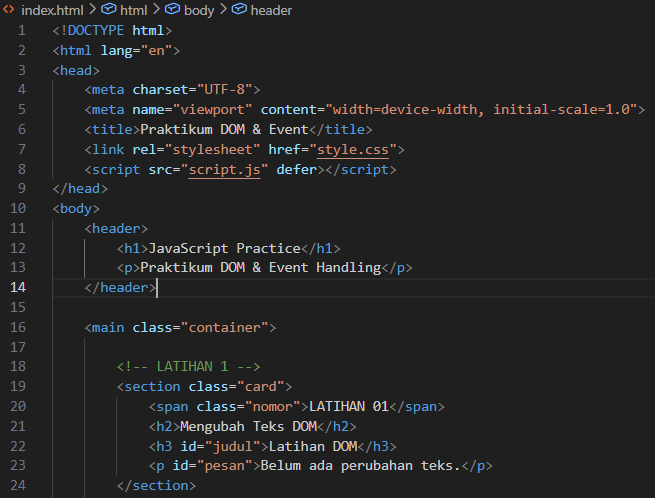

*script.js*
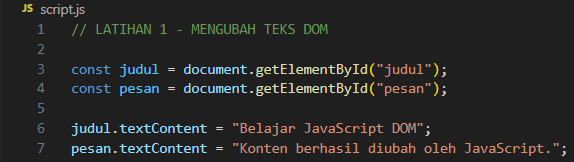

Mengapa memakai textContent bukan innerHTML?
- `textContent` = (isi sebagai teks polos) itu menulis teks apa adanya. Jika user mengetik sesuatu,
akan tampil tulisan yang sama persis
- `innerHTML` = (isi sebagai HTML) itu menempel konten yang tag-nya dibaca jadi format sungguhan. (Berbahaya)

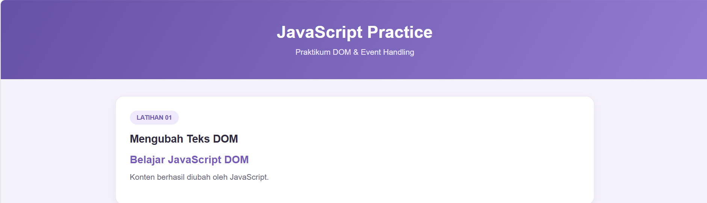

### 2. Event Click
Menampilkan waktu saat tombol diklik.

*index.html*
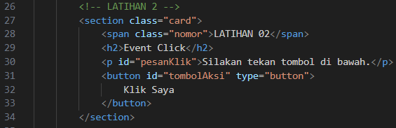

*script.js*
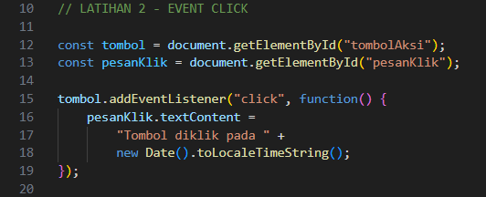
- `addEventListener` = berfungsi untuk membuat event (click, change) dan menjalankan fungsi (callback)
- `submit` = saat form dikirim
- `input` = saat user mengetik di input
- `mouseover` = saat mouse lewat di atas elemen

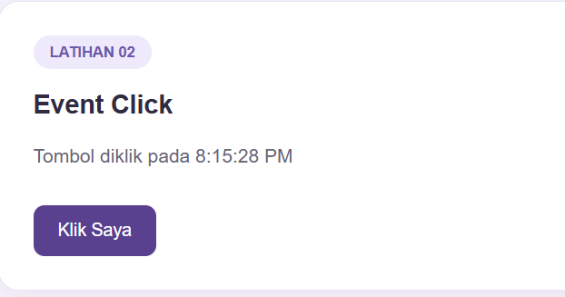

### 3. Mengubah Gaya CSS
Mengganti tampilan tanpa ubah file CSS.

*index.html*
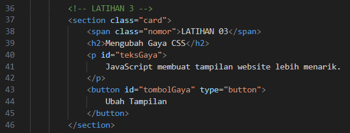

*style.css*
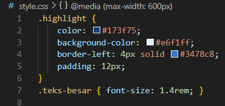

*script.js*
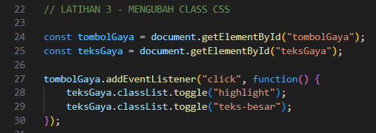
- `classList.add("highlight")` -> Selalu tambah
- `classList.remove("highlight")` -> Selalu hapus
- `classList.toggle("highlight")` -> Tanda selesai

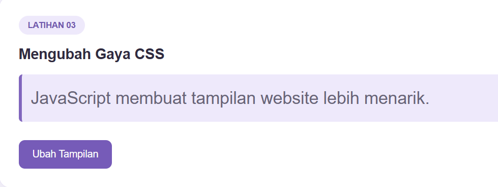

### 4. Event input dan penghitung karakter
Membuat input teks dan indikator jumlah karakter yang diperbarui saat pengguna mengetik. 

*index.html*
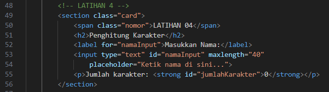
- Event `input` lebih cepat dari `change.input` deteksi tiap ketikan, `change` menunggu user selesai & klik luar.

*script.js*
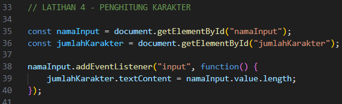

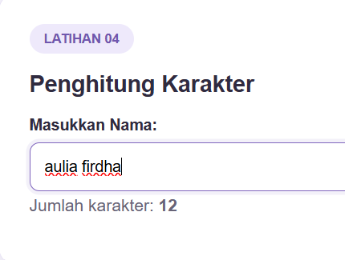

### 5. Validasi Form
Membuat form nama, email, dan usia.

*index.html*
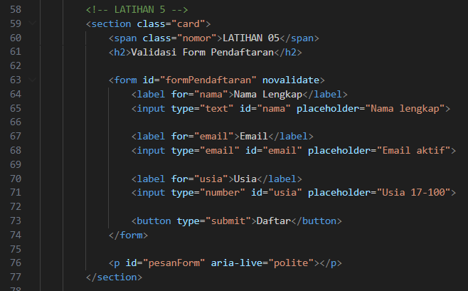
- `novalidate` = artinya "Matikan validasi bawaan browser". Karena kita mau bikin validasi kita sendiri pakai JS.
- `id="pesanForm"` = tempat untuk menampilkan pesan error/sukses.
- `aria-live="polite"` = jika ada screen raeder, dia akan bacakan pesan errornya.

*script.js*
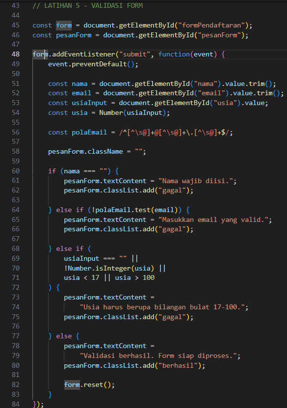
- `event.preventDefault` = kalau kita klik tombol `type=submit`, browser akan langsung reload halaman & kirim data.
Tanpa ini, validasi tidak akan pernah terlihat.
- `.value.trim()` = Validasi nama tidak kosong
    - `.value` = ambil isi ketikan user.
    - `.trim()` = buang semua spasi di depan & belakang.

### 6. Daftar tugas sederhana (To-do List)
Membuat aplikasi kecil untuk menambahkan tugas dan menandai tugas selesai.

*index.html*
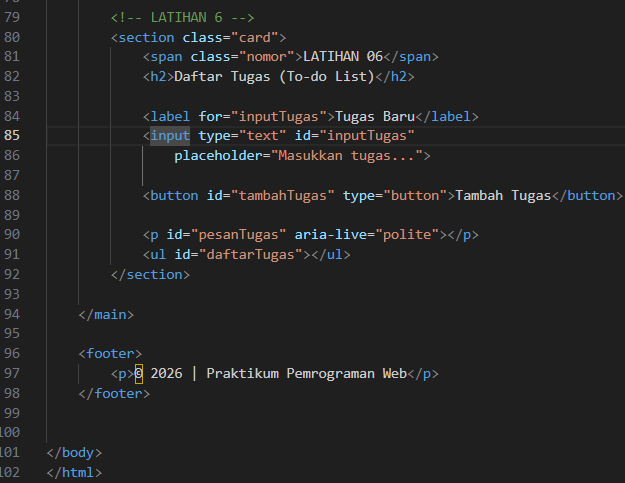
- `<p id ="pesanTugas">` = tempat pesan "Tulis tugas dulu" atau "Tugas ditambahkan"
- `<ul id="daftarTugas"></ul>` = wadah kosong. nanti semua tugas `<li>` akan dimasukkan ke sini oleh JavaScript.

*style.css*
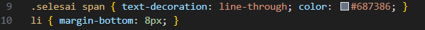
- User klik "Tanda Selesai" -> (CSS) `.selesai span { text-decoration: line-through }` aktif -> tulisan kecoret

*script.js*
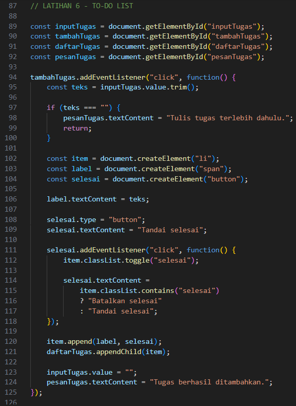


```diff
## Mini Project - Form Workshop
```
Membuat mini project yang berisi :
- Validasi nama, email, dan pilihan sesi.
- Penghitung karakter atau ringkasan input secara langsung.
- Pesan kesalahan dan pesan sukses yang tampil pada halaman.
- Tombol reset atau hapus input.
- Gunakan addEventListener() untuk event input, change, click, atau submit.

*index.html*
```html
<!DOCTYPE html>
<html lang="id">
<head>
  <meta charset="UTF-8">
  <meta name="viewport" content="width=device-width, initial-scale=1.0">
  <title>Pendaftaran Workshop</title>
  <link rel="stylesheet" href="style.css">
  <script src="script.js" defer></script>
</head>
<body>
  <main class="container">
    <section class="form-card">
      <div class="header">
        <span class="tag">WORKSHOP 2026</span>
        <h1>Daftar Workshop</h1>
        <p>Tingkatkan skill teknologi kamu bersama kami!</p>
      </div>
    <!--1-->
      <form id="formWorkshop" novalidate>
        <div class="form-group">
          <label for="nama">Nama Lengkap</label>
          <input type="text" id="nama"
            placeholder="Masukkan nama lengkap"
            maxlength="50">
          <small id="jumlahKarakter">0/50 karakter</small>
          <small class="error" id="errorNama"></small>
        </div>
    <!--2-->
        <div class="form-group">
          <label for="email">Email</label>
          <input type="email" id="email"
            placeholder="contoh@email.com">
          <small class="error" id="errorEmail"></small>
        </div>
    <!--3-->
        <div class="form-group">
          <label for="sesi">Pilih Sesi Workshop</label>
          <select id="sesi">
            <option value="">-- Pilih Sesi --</option>
            <option value="Web Development">
              Web Development
            </option>
            <option value="UI/UX Design">
              UI/UX Design
            </option>
            <option value="Python Dasar">
              Python Dasar
            </option>
          </select>
          <small class="error" id="errorSesi"></small>
        </div>
    <!--4-->
        <div class="ringkasan">
          <h3>Ringkasan Pendaftaran</h3>
          <p>Nama: <span id="previewNama">-</span></p>
          <p>Email: <span id="previewEmail">-</span></p>
          <p>Sesi: <span id="previewSesi">-</span></p>
        </div>
    <!--5-->
        <div id="pesan" role="status" aria-live="polite"></div>
    <!--1-->
        <div class="button-group">
          <button type="submit" class="btn-daftar">
            Daftar Sekarang
          </button>
          <button type="reset" class="btn-reset">
            Reset Form
          </button>
        </div>
      </form>
    </section>
  </main>
</body>
</html>

